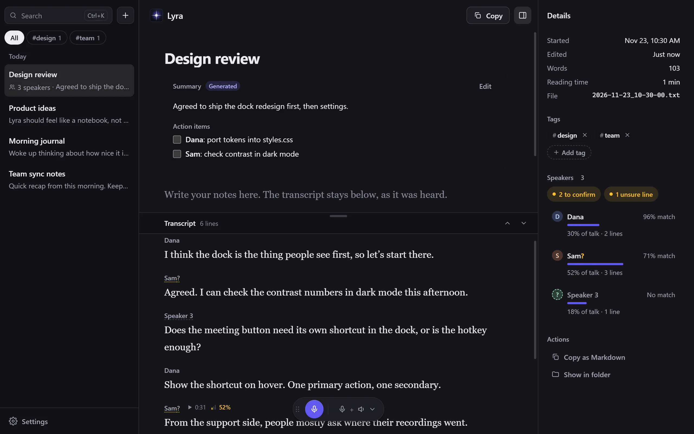

<p align="center">
  
</p>

<h1 align="center">Lyra</h1>

<p align="center">
  <strong>A local voice notebook for desktop.</strong><br />
  Talk, meet, think out loud. Lyra writes it all down, on your machine.
</p>

<p align="center">
  <a href="LICENSE"></a>
</p>

<p align="center">
  
</p>

## Features

- **Local-first**: audio, transcripts, voiceprints, and notes stay on your device
- **Voice + typing**: dictate as you go, edit anytime
- **Plain files**: notes are `.txt` (or `.md`) files in a folder you choose, `~/.lyra` by default, named by when they started
- **Global shortcut**: Ctrl/Cmd+Shift+Space starts a new note from anywhere, and Lyra keeps running in the tray with a small recording pill
- **Mic prompts** (optional): when Zoom, Teams, or Discord turns on your mic, Lyra offers to record
- **Meetings**: records your mic and the computer's audio together (switch computer audio on or off in the recording dock), then labels who said what
- **Voices**: save people's voices so their names show up in transcripts automatically
- **Meeting notes** (optional): summary, decisions, and action items, written on your computer or, if you opt in, by a cloud model you choose (Anthropic, OpenAI, Google, or your own OpenAI-compatible server)
- **On-device speech**: transcription with [Whisper](https://github.com/ggml-org/whisper.cpp), speakers with [sherpa-onnx](https://github.com/k2-fsa/sherpa-onnx), notes with [llama.cpp](https://github.com/ggml-org/llama.cpp)

## Quick start

**Requirements:** Node.js 22 (22.18 or later), pnpm

```bash
git clone https://github.com/osbytes/lyra.git
cd lyra
pnpm install
pnpm dev
```

Grant microphone access when prompted. Models download on first use:

- **Whisper `large-v3-turbo`** (~575 MB), on the first recording
- **Speaker models** (~46 MB), on the first meeting
- **Local notes model** (~2 GB), only if you turn on local meeting notes

On macOS, capturing a call's audio needs Screen Recording permission.

## Privacy

Everything runs on this computer by default. The only exception is meeting notes **with a cloud model**, which you have to switch on yourself. It sends the meeting transcript (never audio or voiceprints) to the provider you pick, using your own key, which is stored in the system keychain. Recording other people usually requires their consent.

## Build

```bash
pnpm build:mac     # dmg + zip
pnpm build:win     # NSIS installer
pnpm build:linux   # AppImage + deb
```

## Contributing

Issues and PRs are welcome. See [CONTRIBUTING.md](CONTRIBUTING.md). This project follows the [Contributor Covenant](CODE_OF_CONDUCT.md).

## License

[MIT](LICENSE) — Whisper model weights are subject to their upstream terms.
